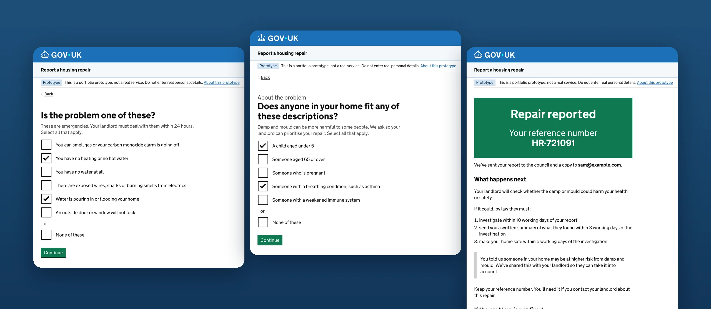

# Report a housing repair

A self-initiated prototype by Calie Boateng, built with the [GOV.UK Prototype Kit](https://prototype-kit.service.gov.uk/) and [GOV.UK Frontend](https://frontend.design-system.service.gov.uk/).

It imagines a GOV.UK service that lets people who rent from a council or housing association in England report a repair to their landlord, and tells them what their landlord must do next under Awaab’s Law.

**This is not a real service.** Reports are not sent anywhere.

Try it: https://report-a-housing-repair.onrender.com (password: `housingrepair`)



## The journey

1. Start page
2. Who is your landlord? (private renters and “not sure” leave with help)
3. Is the problem one of these? (emergency check: gas goes straight to the gas emergency number)
4. What is the problem?
5. Damp and mould only: how much, and is anyone in the home at higher risk
6. Where in your home, describe the problem, how long, reported before
7. Photos (optional)
8. Postcode, select address or enter it manually
9. Name and how to be contacted
10. When someone can visit, and anything the repair team should know
11. Check your answers, with change links that return here
12. Confirmation with a reference number and the legal timescales that apply

Every question validates, with an error summary linked to the field, following the GOV.UK Design System.

## Where things are

- `app/views/` – one file per page
- `app/routes.js` – branching, validation and error messages
- `app/lib/labels.js` – the wording for every answer, used on the check answers page
- `app/filters.js` – small helpers for the templates

## Run it on your computer

You need Node.js 20 or later.

```
npm install
npm run dev
```

Then open http://localhost:3000

## Put it online

The kit asks for a password when it runs online. Set a `PASSWORD` environment variable on your host and share it with anyone you want to see the prototype.

On [Render](https://render.com):

1. Push this folder to a GitHub repository.
2. In Render, create a new **Web Service** from that repository.
3. Build command: `npm install`
4. Start command: `npm start`
5. Add environment variables: `NODE_ENV` = `production` and `PASSWORD` = a password of your choice.
